<div align="center">

# 🌷 Tend

### A garden that grows with your hands

**Hands-first VR & mixed-reality hand rehabilitation for Meta Quest.**
Every gentle movement plants something new, and your garden (your recovery, made visible) is still there tomorrow.

[**▶ Try it live**](https://batmandevx.github.io/tend-vr/) · [Watch the autopilot demo](https://batmandevx.github.io/tend-vr/?demo&fresh) · [Mirror-therapy demo](https://batmandevx.github.io/tend-vr/?demo=mirror&fresh)


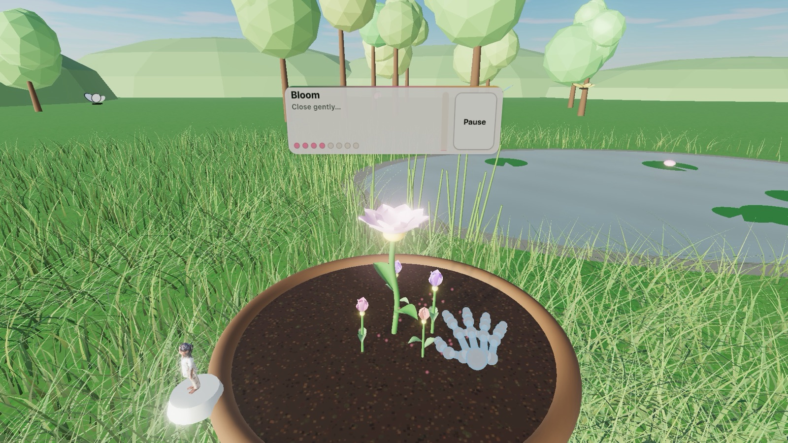

*Open your hand and the flower opens with you. Every completed rep plants a new flower.*

</div>

---

## Contents

1. [Why Tend exists](#why-tend-exists)
2. [The experience, screen by screen](#the-experience-screen-by-screen)
3. [The five exercises](#the-five-exercises)
4. [Built for hands that don't work perfectly](#built-for-hands-that-dont-work-perfectly)
5. [Mirror therapy](#mirror-therapy)
6. [Keepsakes: bring your real world in (Camera to 3D)](#keepsakes-bring-your-real-world-in-camera-to-3d)
7. [Reasons to come back](#reasons-to-come-back)
8. [How it works](#how-it-works)
9. [Graphics & performance](#graphics--performance)
10. [Run it](#run-it)
11. [Project structure](#project-structure)
12. [How Tend maps to the competition criteria](#how-tend-maps-to-the-competition-criteria)
13. [Roadmap](#roadmap)
14. [Safety, privacy & credits](#safety-privacy--credits)

---

## Why Tend exists

About **12 million people have a stroke every year**, and most survivors live with weakness or poor control in an arm or hand. Add hand fractures, tendon repairs, carpal-tunnel surgery and arthritis, and the number of people doing hand rehab at home is enormous.

Recovery depends on **repetition**: hundreds of fist-opens, finger pinches and wrist turns every day, often for months. Clinicians hand patients a printed sheet, and most people stop doing it. The exercises are boring, there's no feedback, and progress is too slow to notice.

Quest hand tracking changes the equation. The headset sees **25 joints per hand**, so it can measure every rep without gloves, sensors or controllers. Tend turns that measurement into something people *want* to do every day: a calm garden where each movement plants a flower, and where the progress you can't feel becomes something you can see.

> **The test we designed against:** could a 70-year-old who just came home from hospital, with one hand that barely moves, put on a headset, finish a session without help, and want to come back tomorrow?

---

## The experience, screen by screen

### 1. Sunrise: the first ten seconds
The headset opens in pre-dawn darkness. The sun rises over the meadow, a single bud in your planter opens, and the title appears. No menus, no tutorial wall: just a calm place to sit.

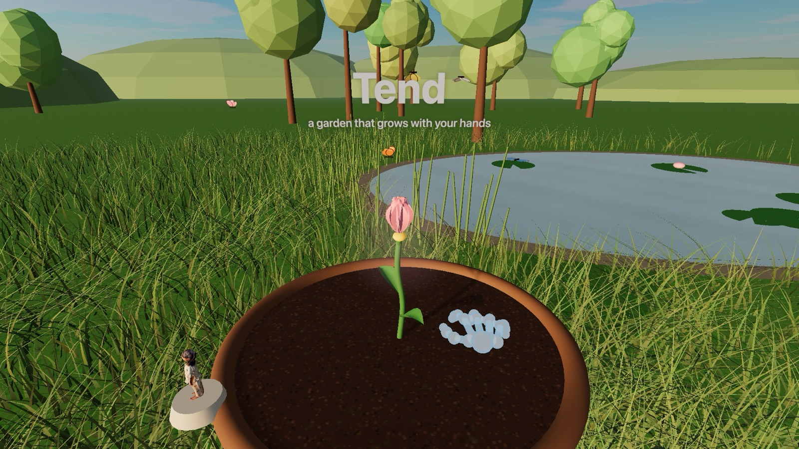

### 2. Welcome & one-minute setup
Large, high-contrast panels within arm's reach. Every button can be **poked** or simply **hovered with a fingertip** for about a second (dwell-to-press), so a shaky or weak hand can still use it. Setup asks just three things: which hand, whether to use mirror therapy, and session length.

| Welcome | Mirror-therapy offer |
|---|---|
| 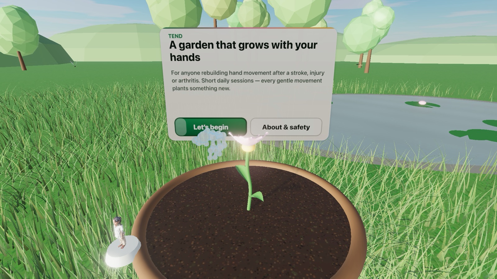 | 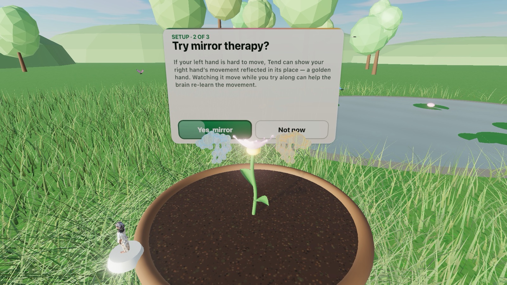 |

### 3. Learning *your* range
A 30-second calibration measures your relaxed open hand, your widest comfortable spread and your gentlest fist. Every goal from then on is a percentage of **your** range, not a "normal" hand.

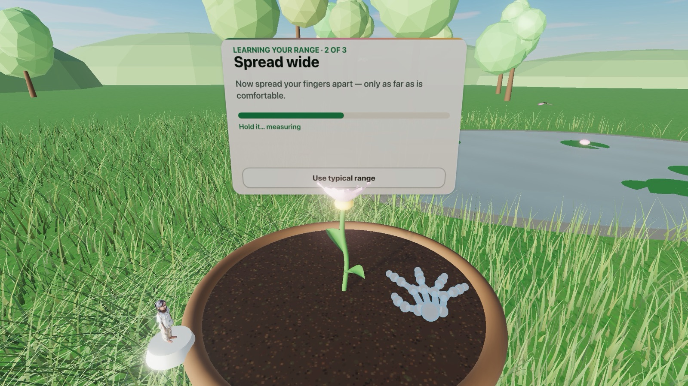

### 4. The session
Five short exercises (3- or 6-minute sessions). A small heads-up panel shows the current cue, rep dots and a live meter of how close you are to the goal. The meter is driven by your actual joint angles.

| Bloom: fist | Bloom: open |
|---|---|
| 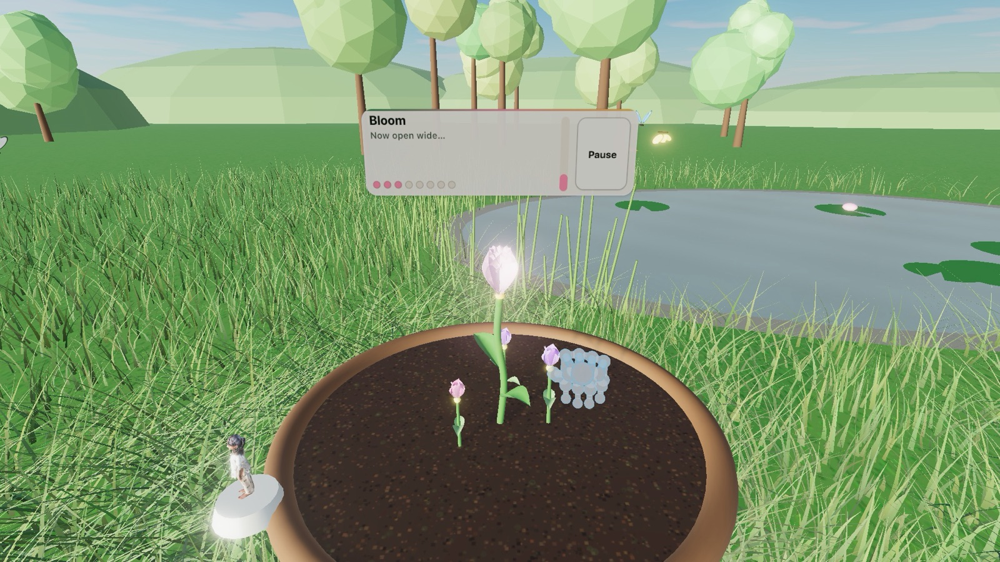 |  |

### 5. Celebration, summary & progress
Each finished exercise gets a chime and a sparkle burst. The summary compares today with your last session (hand closure %, finger spread °, wrist turn °, seconds per pinch). The adaptive coach tells you which goals it will raise next time.

| Session summary | Range over time |
|---|---|
| 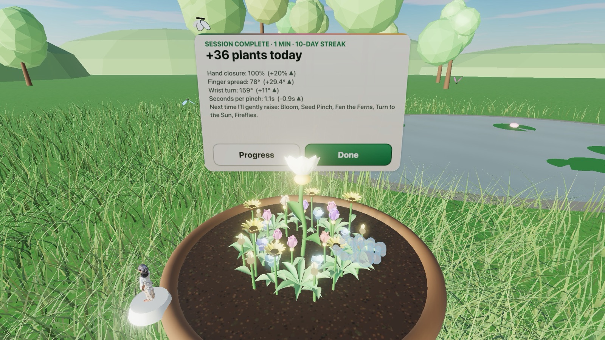 | 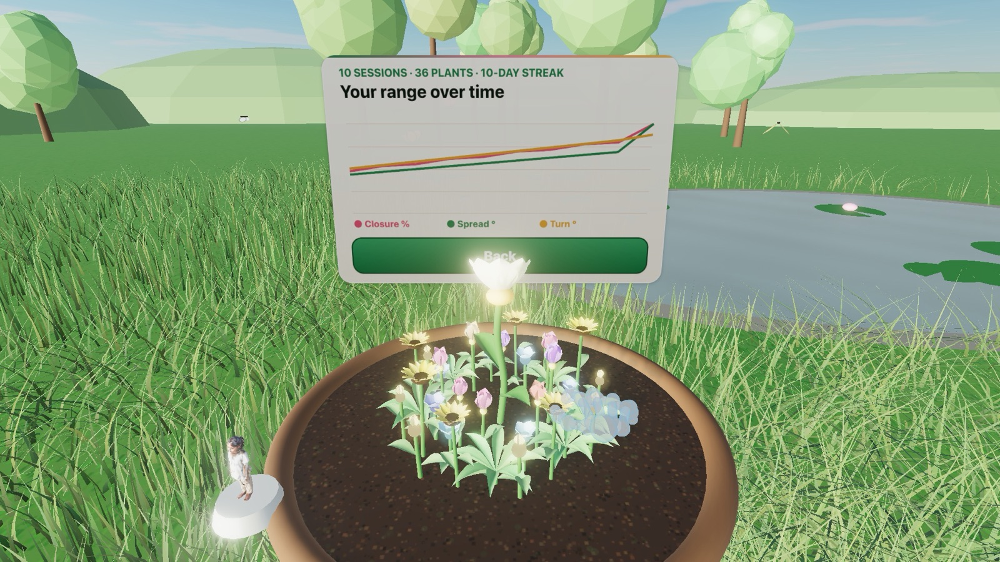 |

<sub>The progress chart shows nine sample sessions, generated so the chart is visible in screenshots. In real use it fills in from your own sessions.</sub>

---

## The five exercises

These are movements that occupational and hand therapists commonly prescribe, each turned into a moment in the garden:

| | Exercise | Movement trained | What you see | How it's measured |
|---|---|---|---|---|
| 🌷 | **Bloom** | Finger flexion/extension (fist ↔ open) | The large central "heart bloom" opens and closes **live with your hand** (biofeedback) and plants tulips | Mean curl of the 4 fingers from joint-angle sums along each finger |
| ✨ | **Seed Pinch** | Thumb opposition to each fingertip in turn | The target fingertip **glows on your real hand**; each touch plants a glowing seedlight | Thumb-tip ↔ fingertip distance ÷ your hand size |
| 🌿 | **Fan the Ferns** | Finger abduction (spreading) | Ferns unfurl; the bloom's petals widen with your spread | Index-to-pinky angle, projected onto the palm plane |
| 🌻 | **Turn to the Sun** | Forearm supination/pronation | The flower turns its face toward the sun as your palm turns up | Palm-normal vs. world-up |
| 🪲 | **Fireflies** | Seated reach & hand–eye coordination | Touch drifting fireflies with any finger; caught ones become glowing lanterns | Fingertip/palm proximity, inside a reach bubble scaled to you |

| Seed Pinch | Fan the Ferns |
|---|---|
| 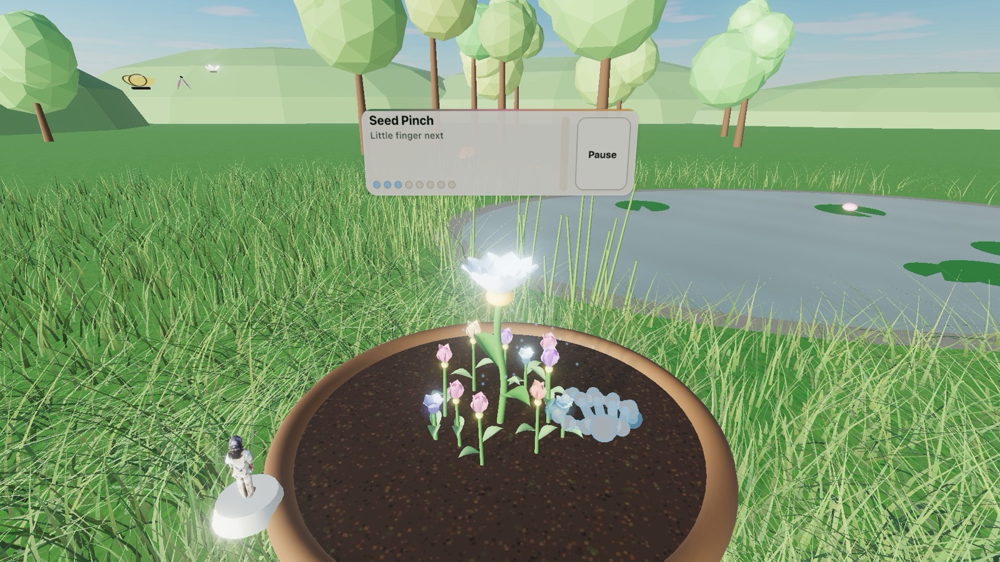 | 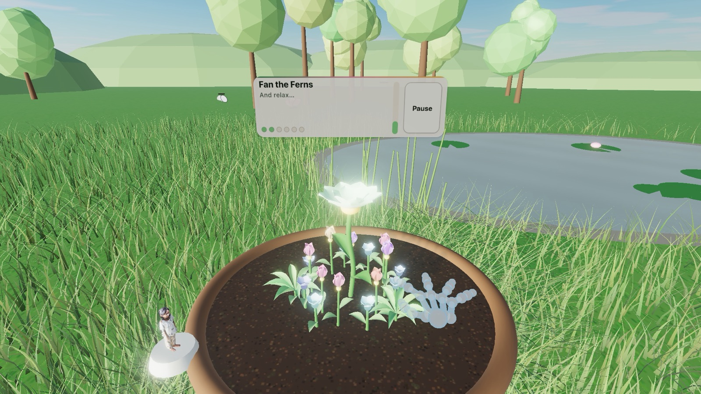 |
| **Turn to the Sun** | **Fireflies** |
| 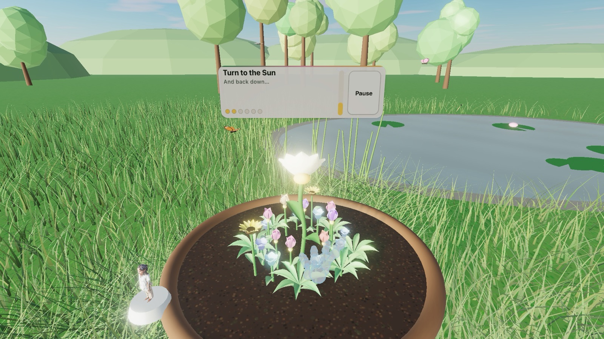 | 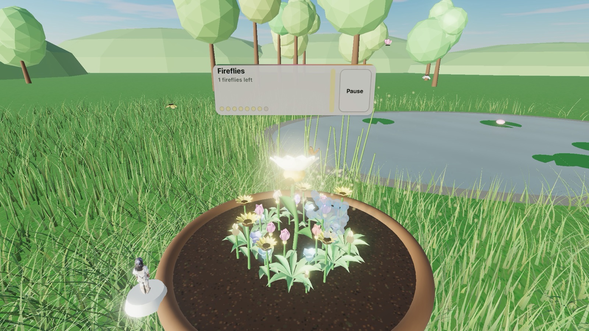 |

---

## Built for hands that don't work perfectly

Most fitness apps assume a healthy body and measure you against it. Tend does the opposite.

- **Personal calibration.** Goals are fractions of your own measured range, so a hand that closes only 30% can still "complete" every rep.
- **Never-fail adaptation (in the moment).** If you're clearly trying, reaching at least about 55% of the goal for 7 seconds, Tend quietly lowers the goal and tells you kindly: *"That's your range today, and that's perfect. I've moved the goal to meet you."* Fireflies drift closer if they're out of reach. Pinch targets get more forgiving.
- **Adaptive coach (between sessions).** Each exercise has its own difficulty level. Easy, fast sessions raise it by 5%; sessions that needed adapting lower it.
- **Dwell-to-press.** Any button activates by holding a fingertip near it for about 1.3 seconds, with a visible fill bar. No precise poke needed.
- **Seated and small.** Everything happens over a lap-height planter, inside a two-foot bubble (the "airplane seat test").
- **Pauses itself.** If your hand leaves view for 3 seconds, or the headset comes off, the session pauses, then resumes once your hand has been back in view for about a second.
- **Many channels at once.** Spoken coaching *and* captions, large type, high-contrast glass panels, and audio chimes that rise in pitch with each rep.
- **Short by design.** 3-minute and 6-minute sessions, with something satisfying in the first minute.

---

## Mirror therapy

Mirror therapy is a long-established rehab technique. The patient watches a reflection of their healthy hand moving where the affected hand should be, which can help the brain re-learn movement. Clinically, it needs a mirror box and a therapist.

In Tend it's a single toggle. The healthy hand's 25 joints are reflected across your body's midline every frame and drawn as a **golden hand** in place of the affected one. You try to move along with it. Reps are measured from the healthy hand, so the session still progresses and the garden still grows.

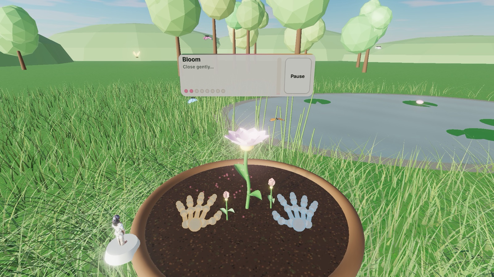

---

## Keepsakes: bring your real world in (Camera to 3D)

Tend connects to our other project, [**Camera to 3D**](https://github.com/batmandevx/Auto-Blender-Camera-to-blender). It turns a phone photo into a textured 3D model **on your own Mac** (segmentation, then Hunyuan3D-2, then photo-projected textures), with no cloud involved.

Photograph something you love, such as a grandchild's toy, your favourite mug or a medal, and it appears on a stone pedestal on your planter's rim. **Pinch it to pick it up** and turn it in your hand. It follows your hand's full position and rotation. That small act is grip, pinch and wrist-rotation practice wrapped in something personal.

#### From your phone to your planter

| 1 · Snap it on your phone | 2 · A textured 3D model, made on your Mac | 3 · It appears in your garden |
|---|---|---|
| 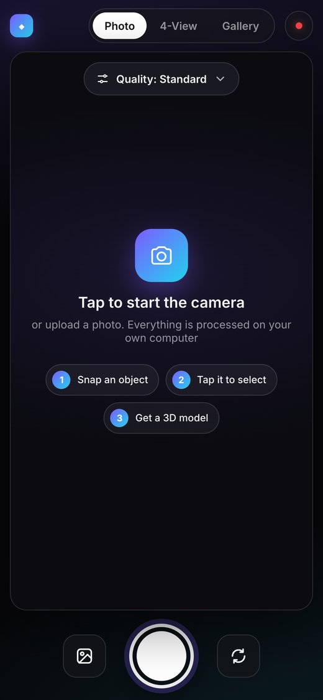 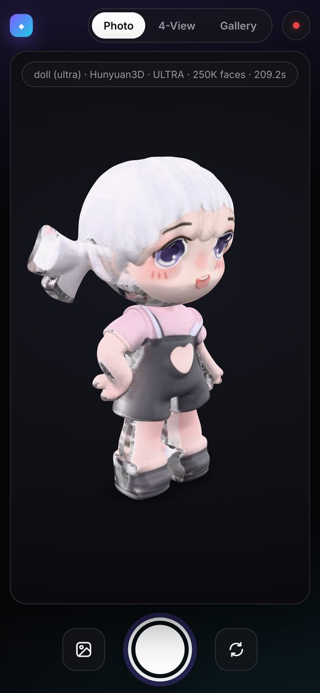 | 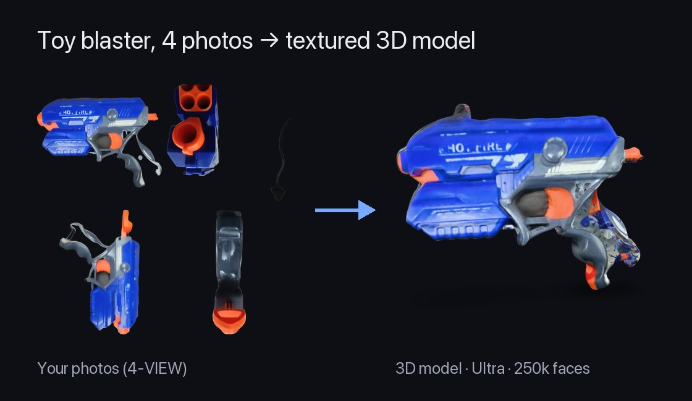 | 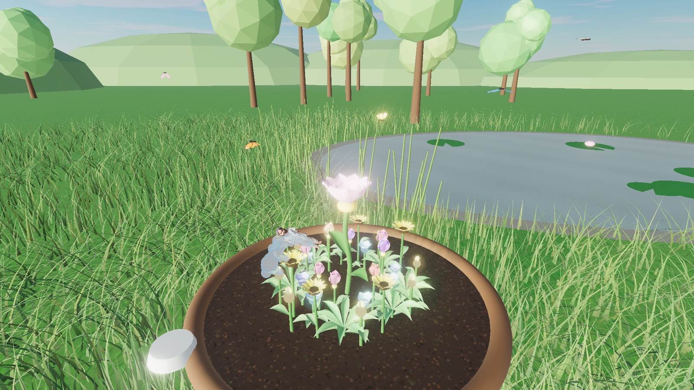 |

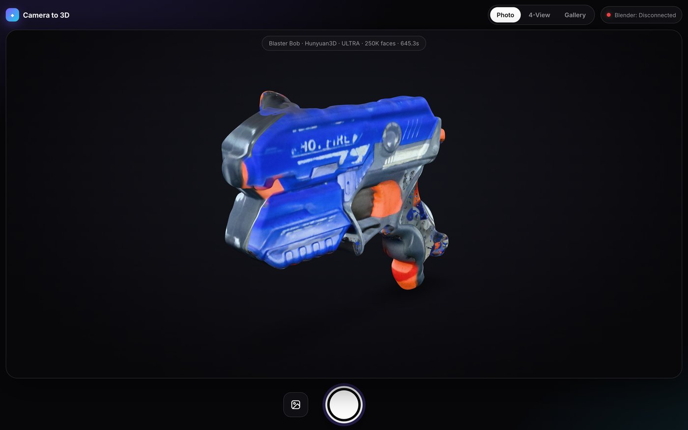

<sub>Screenshots from <a href="https://github.com/batmandevx/Auto-Blender-Camera-to-blender">Camera to 3D</a>. The toy blaster scanned there is the same model sitting on Tend's planter above.</sub>

**How to add one**
1. Run Camera to 3D on your Mac and scan an object.
2. In Tend's 2D page, open **🪴 Keepsakes**, enter the Camera-to-3D address (e.g. `https://192.168.1.20:8443`) and press **Connect**. In the Quest browser, open that address once first and accept its certificate.
3. Tap a scan to plant it. You can also drop in **any `.glb` file**.

Keepsakes are stored in the headset's IndexedDB, so they survive restarts and work offline. Up to four are shown on the rim at once.

---

## Reasons to come back

- **The garden persists.** Every rep you've ever done is a plant. Plants fill the planter in a golden-angle spiral; after about 150 reps they spill into the meadow around you. A month in, you sit in a field you grew with your own hands.
- **Streaks**, gently counted: missing today doesn't break yesterday's streak until tomorrow.
- **Visible progress.** A range-of-motion chart across sessions.
- **Personal keepsakes** waiting on the planter rim.

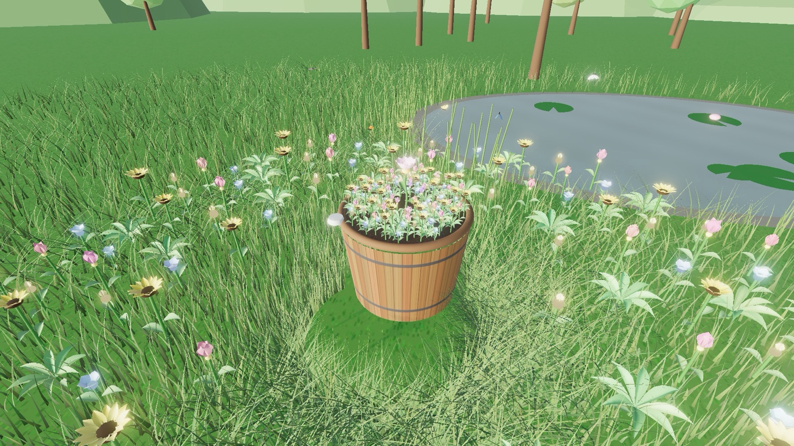

---

## How it works

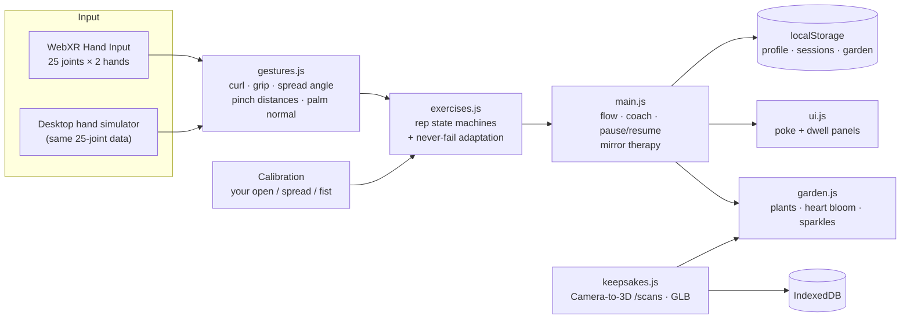

### Gesture math (in `src/gestures.js`)
Everything is normalised by **your hand size** (wrist to middle knuckle), so the same thresholds work for a child's hand and a large adult hand.

- **Finger curl:** sum of the three bend angles along metacarpal → proximal → intermediate → distal → tip, normalised to 0–1.
- **Grip:** mean curl of the four fingers.
- **Spread:** angle between the index and pinky proximal phalanges, projected onto the palm plane so curl doesn't pollute it.
- **Palm normal:** cross product of wrist→index-knuckle and wrist→pinky-knuckle, sign-corrected per hand. Its vertical component drives the supination exercise.
- **Pinch:** thumb-tip to each fingertip distance ÷ hand size.

### Rep detection (in `src/exercises.js`)
Each cycle exercise is a two-phase state machine (**go** to target, then **return** to rest) running on a smoothed metric. That gives clean reps with hysteresis and no double counting. While you're working toward a target, Tend tracks your best attempt. If you're clearly trying but stuck, the target moves to meet you.

### Mirror therapy (in `src/gestures.js` `mirrorHand`)
Every joint is reflected across the vertical plane through your head, with normal along your right vector, captured when the session is recentred.

---

## Graphics & performance

Everything is **procedural**: no downloaded models, textures or audio. The whole app is one small JavaScript bundle plus three.js.

- **Physically based sky** (three.js `Sky`) with drifting clouds, and **image-based lighting** generated from it via PMREM. A sunrise animates the sky, sun, fog and environment light together.
- **Soft shadows** from a sun light whose shadow frustum hugs the planter, where your attention is.
- **26,000 wind-swept grass blades** in one instanced draw call, animated in the vertex shader with layered gusts.
- **Sculpted flowers:** custom cupped, teardrop petal geometry with vertex-colour gradients. Five species with their own forms, all drawn through a handful of instanced meshes, so thousands of plants cost almost nothing.
- **The heart bloom:** two layers of sheen-shaded petals (`MeshPhysicalMaterial`) whose opening is driven live by your grip.
- **Fresnel "spirit hands":** a custom shader with a bright rim, readable against any background, in blue for your hands and gold for mirror therapy.
- **Water** with a fresnel sky reflection and soft ripples, plus lily pads, reeds and **butterflies**.
- **Frosted-glass UI** rendered at 2048 px for crisp text in the headset.
- **Bloom** post-processing in the desktop preview (skipped in the headset, which renders straight to the eye buffers).
- **Headset budget:** grass density drops to 55% in XR, the shadow map is 1024², fixed foveation is enabled, and only growing plants rewrite their instance matrices.

Audio is synthesised with WebAudio: a soft ambient pad and wind, plus pentatonic chimes that climb with each rep. Speech uses the platform's speech synthesis.

---

## Run it

### On Meta Quest (recommended)
Open **https://batmandevx.github.io/tend-vr/** in the Quest Browser and press **Enter VR**, or **Enter MR (passthrough)** to put the planter on your real table. Make sure hand tracking is on: *Settings → Movement tracking → Hand tracking*.

### Desktop preview (no headset)
Open the same URL in Chrome. A simulated hand produces the same 25-joint data the headset would.

| Control | Action |
|---|---|
| Mouse | Move the hand · click panel buttons |
| **Space** | Push forward (poke) |
| **F** / **G** / **O** | Fist / spread / open |
| **T** | Turn palm up |
| **1–4** | Pinch thumb to index / middle / ring / little finger |
| **H** | Switch hand · mouse wheel = depth |

URL flags: `?demo` (an autopilot plays a whole session), `?demo=mirror`, `?fresh` (ignore saved progress), `?nointro`, `?camera3d=<url>` (open the keepsake drawer and connect).

### Develop
```bash
npm install
npm run dev              # http://localhost:5173
HTTPS=1 npm run dev      # HTTPS on your LAN, to open the dev server on a Quest
npm run build            # static site in dist/
```
Pushing to `main` deploys to GitHub Pages via `.github/workflows/deploy.yml`.

---

## Project structure

```
tend/
├── index.html              # page shell, Enter VR / MR buttons, keepsake drawer
├── src/
│   ├── main.js             # app flow, sunrise intro, coach, pause/resume, mirror therapy, render loop
│   ├── hands.js            # WebXR joint reading + procedural 25-joint simulated hand
│   ├── gestures.js         # curl, grip, spread, pinch, palm normal, mirroring
│   ├── exercises.js        # the five exercises, rep state machines, adaptation
│   ├── garden.js           # sky, lighting, grass, pond, planter, plants, heart bloom, butterflies
│   ├── handview.js         # fresnel "spirit hand" rendering
│   ├── ui.js               # frosted-glass world-space panels, poke + dwell input
│   ├── keepsakes.js        # Camera-to-3D integration, IndexedDB, pinch-grab
│   ├── sim.js              # desktop simulator + autopilot (end-to-end test & demo)
│   ├── audio.js            # synthesised ambience, chimes, speech
│   └── store.js            # local profile, sessions, streaks
├── docs/screenshots/       # images in this README (rendered from the app itself)
└── SUBMISSION.md           # competition write-up
```

---

## How Tend maps to the competition criteria

| Requirement / award | How Tend answers it |
|---|---|
| **Hands-first** | No controller anywhere. Hands are the menu input *and* the therapy. |
| **Seated-optimised (airplane seat test)** | Everything happens over a lap-height planter inside a two-foot bubble. |
| **Easy in, easy out (bus stop test)** | Opens in seconds, 3-minute quick sessions, automatic pause/resume. |
| **Original, not a wrapper** | Entirely self-built: gesture math, exercises, procedural world and audio. |
| **Best Accessibility Forward Experience** | Personal calibration, never-fail adaptation, dwell-to-press, mirror therapy, captions + voice. |
| **Best Reason to Come Back** | A persistent garden that spills into the meadow, streaks, range-of-motion chart, personal keepsakes. |
| **Best First Five Minutes** | Sunrise opening → three-question setup → 30-second calibration → the flower opening with your hand. |
| **Boldest Original Concept** | Mirror therapy without a mirror box, and photos of your real belongings as rehab objects. |

---

## Roadmap

- **Clinician mode:** a therapist sets the prescription (exercises, reps, ranges) and receives an exported progress report.
- **More exercises:** tendon glides, finger-tapping speed, wrist flexion/extension, two-handed tasks.
- **Co-op visits:** a family member joins from their own headset and waters the garden with you.
- **Seasons:** the garden changes with the calendar, so long-term users see time pass.
- **Clinical pilot** with a stroke-rehabilitation clinic to validate engagement and range-of-motion tracking.

---

## Safety, privacy & credits

**Safety.** Tend is a wellness companion, **not a medical device**, and does not diagnose or treat any condition. Move only within a pain-free range and follow your clinician's advice.

**Privacy.** No account, no server, no analytics. Your profile, sessions, garden and keepsakes live only in the browser storage on your headset.

**Built with** [three.js](https://threejs.org) and the WebXR Device API (Hand Input), Vite, and GitHub Pages. Keepsakes come from [Camera to 3D](https://github.com/batmandevx/Auto-Blender-Camera-to-blender).

**Author:** Ayush Upadhyay
